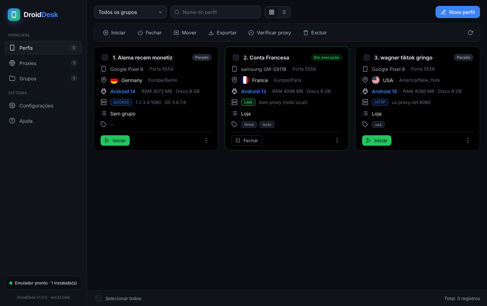

# DroidDesk

Gerenciador de telefones Android virtuais para PC, no estilo **GeeLark / AdsPower**: cada perfil é um
emulador Android isolado (apps, logins e armazenamento próprios), com **proxy individual**
(HTTP, HTTPS, SOCKS5, com ou sem senha), **país, fuso horário e idioma** configuráveis, grupos, tags,
verificação de IP e muito mais. Funciona com ou sem proxy.



## Duas abas, dois tipos de perfil

- **Perfis (Android):** telefones virtuais completos no emulador oficial do Google.
- **Navegadores:** perfis de navegador isolados (Chrome, Edge, Brave ou Chromium já instalados no PC),
  cada um com cookies, logins, cache, proxy, idioma e tamanho de janela próprios, como no AdsPower.
  Os dados de cada perfil ficam em `browser-profiles/<id>` dentro da pasta de dados do app.

## Como funciona

- Usa o **emulador oficial do Android (Google)**: gratuito, estável e com imagens de sistema do
  Android 9 ao 16, inclusive com Google Play.
- Cada perfil vira um AVD próprio (hardware, resolução, RAM e disco escolhidos por você).
- Todo o tráfego do telefone passa por uma **ponte de proxy local** do DroidDesk, que encaminha para
  o seu proxy. Isso permite SOCKS5 com autenticação, que o emulador não suporta nativamente.
- Perfis sem proxy usam a rede do computador (`LAN`).

## Requisitos

| Item | Detalhe |
|---|---|
| Sistema | Windows 10/11 64-bit, macOS ou Linux |
| Virtualização | Intel VT-x / AMD-V ativado na BIOS |
| Windows | Ativar **Windows Hypervisor Platform** (ou Hyper-V) em "Ativar ou desativar recursos do Windows" |
| Memória | 8 GB ou mais (cada telefone usa 2 a 4 GB) |
| Java JDK 17 | Necessário apenas para o instalador automático do SDK (botão de download dentro do app) |

## Instalação (usuário final)

1. Baixe `DroidDesk-Setup-x.y.z.exe` na aba **Releases** (ou gere o instalador, veja abaixo).
2. Instale e abra o DroidDesk.
3. Em **Configurações → Baixar e instalar**, o app baixa o emulador, o ADB e uma imagem do Android
   (1 a 2 GB). Se você já tem o Android Studio, o SDK é detectado automaticamente.
4. Cadastre proxies em **Proxies** e clique em **Verificar** para ver IP e país.
5. **Novo perfil** → escolha modelo, versão do Android, país e proxy → **Iniciar**.

## Rodar a partir do código

```bash
cd droiddesk
npm install
npm start
```

## Gerar o executável / instalador

```bash
npm run dist:win     # Windows: DroidDesk-Setup-1.0.0.exe (instalador) + versão portátil
npm run dist:mac     # macOS: .dmg
npm run dist:linux   # Linux: AppImage + .deb
```

Os arquivos ficam em `droiddesk/dist/`. O instalador do Windows deve ser gerado no próprio
Windows (ou em Linux com `wine` instalado).

### Build automático e atualização automática

O app usa **electron-updater**: ao abrir (e a cada 4 horas) ele consulta as *Releases* do GitHub,
baixa a versão nova em segundo plano e pergunta se quer reiniciar para instalar. Só a versão com
instalador (Setup) se atualiza sozinha; a portátil apenas avisa.

Para publicar uma versão nova:

```bash
cd droiddesk
npm version patch        # 1.0.1 -> 1.0.2 (ou minor/major)
git push origin main
git push origin v1.0.2   # a tag dispara o workflow
```

O workflow `.github/workflows/droiddesk-build.yml` compila no Windows, cria a Release `v1.0.2` e
anexa `DroidDesk-Setup-1.0.2.exe` + `latest.yml`. Em alguns minutos todos os apps instalados
recebem a atualização. O workflow precisa existir no branch `main` para o GitHub reconhecê-lo.

Também é possível rodar manualmente (aba *Actions* → *Run workflow*) para gerar os arquivos como
*Artifacts*, sem publicar release.

## Testes

```bash
npm test          # backend: ponte de proxy (SOCKS5/HTTP com auth), store, AVD, detecção do SDK
node test/ui.js   # interface: percorre todas as telas em Chromium com API simulada (precisa de playwright)
```

## Estrutura

```
droiddesk/
├─ src/main/
│  ├─ main.js       # processo principal (Electron), IPC
│  ├─ emulator.js   # inicia/para emuladores, boot, diagnóstico
│  ├─ proxy.js      # ponte de proxy local + verificação de IP
│  ├─ avd.js        # cria/apaga telefones virtuais (sem precisar de Java)
│  ├─ sdk.js        # detecta e instala o Android SDK
│  ├─ store.js      # persistência JSON atômica
│  └─ meta.js       # modelos de aparelho, países, versões do Android
├─ src/preload.js   # ponte segura (contextIsolation) renderer ↔ main
├─ src/renderer/    # interface (HTML/CSS/JS puro, PT-BR e EN)
├─ build/           # ícone
└─ test/            # testes
```

## Segurança e integridade dos dados

- Renderer isolado (`contextIsolation`, `sandbox`, CSP restritiva); o renderer só fala com o
  processo principal por IPC validado.
- Senhas de proxy são gravadas criptografadas (Electron `safeStorage`, chave do usuário do SO).
- A ponte de proxy escuta apenas em `127.0.0.1`.
- Excluir um perfil exige confirmação com a lista de nomes e um aceite explícito. Nenhuma outra
  operação (atualização, reinstalação, troca de versão) apaga telefones virtuais ou perfis de navegador.
- Se a pasta dos telefones virtuais estiver inacessível (por exemplo, unidade externa desconectada), o
  app recusa iniciar perfis em vez de recriá-los vazios.

## Onde ficam os dados

- Perfis, proxies e configurações: pasta de dados do app (mostrada em *Configurações*).
- Telefones virtuais (apps, contas): pasta AVD (`~/.android/avd`). Faça backup dela para preservar as contas.
